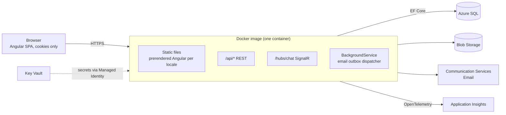
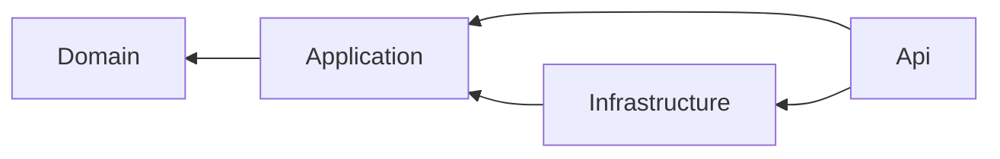
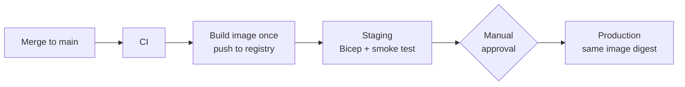

# Pracownia Bajkowe Cuda

[](https://github.com/Darin2020/PracowniaBajkoweCuda/actions/workflows/ci.yml)
[](https://github.com/Darin2020/PracowniaBajkoweCuda/actions/workflows/codeql.yml)
[](LICENSE)

Mobile-first one-page website for a custom toy-sewing **service** (not a shop). Visitors see the About, Gallery,
Pricing and Contact sections. Registered customers chat with the owner, the owner turns conversations into orders,
and customers follow those orders.

The project is also a portfolio piece for **Docker, Azure and CI/CD**: one container, infrastructure as code,
and a build-once / promote pipeline.

> **Status:** Phase 1 (public site, i18n, SEO, container) is done: the prerendered one-page site in five languages
> runs from the Docker image. Phase 2 (Azure infrastructure and continuous deployment) is in progress.
> Accounts, chat and orders come next. Texts, prices, contact details and pictures are
> **placeholders**. The roadmap and the full specification are in [docs/PLAN.md](docs/PLAN.md); decisions are logged
> in [docs/DECISIONS.md](docs/DECISIONS.md).

## Stack

| Area | Technology |
|---|---|
| Backend | ASP.NET Core (.NET 10), Clean Architecture, EF Core + SQL Server / Azure SQL, ASP.NET Core Identity, SignalR |
| Frontend | Angular 22 (standalone, signals, zoneless), SCSS, `@angular/localize` (en, de, fr, es, pl), static prerendering |
| Packaging | One Docker image: ASP.NET Core serves the API, the SignalR hub and the prerendered Angular files |
| Azure | Container Apps, Azure SQL, Blob Storage, Key Vault, Communication Services Email, Application Insights (Bicep) |
| CI/CD | GitHub Actions: PR checks → staging automatically → production after manual approval, Azure login through OIDC |

## Architecture



Backend layering (dependencies point inwards; the Domain project has no framework dependencies):



## Repository layout

```
BajkoweCuda.sln
src/backend/BajkoweCuda.Domain           entities, value objects, domain rules
src/backend/BajkoweCuda.Application      use-case handlers, DTOs, ports
src/backend/BajkoweCuda.Infrastructure   EF Core, Identity, Blob, Email
src/backend/BajkoweCuda.Api              HTTP API, SignalR hub, static hosting, security headers
src/frontend                             Angular workspace
  src/app/content                        texts, prices, image lists (edit here, then redeploy)
  src/app/public, shared, core           landing and legal pages, carousel/viewer, SEO and locale helpers
  src/locale                             translations (XLIFF) for de, fr, es, pl
tests/                                   unit and integration tests
scripts/smoke-test.sh                    checks a running instance (used by CI)
infra/                                   Bicep: shared.bicep (registry, Container Apps env), main.bicep (one environment), modules/
scripts/azure-bootstrap.ps1              one-time Azure + GitHub OIDC setup
docs/                                    PLAN.md, DECISIONS.md, RUNBOOK.md
.github/                                 workflows, Dependabot, PR template
Dockerfile                               multi-stage build of the single image
docker-compose.yml                       local SQL Server, Azurite, Mailpit (+ the app with --profile app)
```

## The public site

- **One page, five languages.** Each locale is a separately built Angular app under its own URL prefix
  (`/en/`, `/de/`, `/fr/`, `/es/`, `/pl/`). `/` redirects by the `lang` cookie, then `Accept-Language`, then English.
- **Prerendered, no Node server.** The landing page and the legal pages are static HTML generated at build time, with
  title, description, canonical URL, `hreflang` alternates, Open Graph tags and JSON-LD. Everything else is
  client-rendered from a per-locale shell. `sitemap.xml` and `robots.txt` are generated by the build.
- **Strict Content-Security-Policy.** `script-src 'self'`: no inline scripts and no `eval`. See
  [docs/DECISIONS.md](docs/DECISIONS.md) for the trade-offs.
- **Only strictly necessary cookies**, so there is an information notice instead of a consent banner.

## Run it locally

Prerequisites: Docker with Compose v2. For development also the .NET 10 SDK and Node.js 26 (or 24 LTS).

### The whole application in Docker

```bash
cp .env.example .env                          # then set MSSQL_SA_PASSWORD in .env
docker compose --profile app up -d --build    # http://localhost:8080
scripts/smoke-test.sh http://localhost:8080   # optional: language redirect, pages, headers
```

### Development (hot reload)

```bash
# 1. Local dependencies: SQL Server, Azurite (Blob emulator), Mailpit (SMTP + web UI on http://localhost:8025)
docker compose up -d

# 2. API on http://localhost:5080
dotnet run --project src/backend/BajkoweCuda.Api

# 3. Frontend on http://localhost:4200 (English only; proxies /api, /hubs and /health to the API)
cd src/frontend
npm ci
npm start
```

## Build, test, lint

```bash
dotnet build BajkoweCuda.sln                    # warnings are errors
dotnet test --solution BajkoweCuda.sln          # Microsoft.Testing.Platform runner

cd src/frontend
npm test                                        # Vitest, single run
npm run lint                                    # ESLint (angular-eslint)
npm run format:check                            # Prettier
npm run build                                   # all locales, prerendered, + robots.txt and sitemap.xml
```

On a Windows machine where Smart App Control blocks freshly built binaries, run the backend tests in a container:

```bash
docker run --rm -v "${PWD}:/src:ro" -w /src -v bajkowecuda-nuget:/root/.nuget/packages mcr.microsoft.com/dotnet/sdk:10.0 dotnet test --solution BajkoweCuda.sln --artifacts-path /tmp/artifacts
```

## Content and translations

- Texts, prices, contact details and image lists live in `src/frontend/src/app/content/`. English is the source language.
- After changing or adding text run `npm run i18n:extract` in `src/frontend`. It re-extracts the messages and updates
  `src/locale/messages.{de,fr,es,pl}.xlf`: existing translations are kept, new messages are marked `state="new"`
  and must be translated (the build fails on a missing translation).
- The initial translations are machine-made and marked `state="needs-review-translation"` until a person checks them.
- The public origin used in canonical URLs, `robots.txt` and `sitemap.xml` is **not** part of the build. The build
  writes a placeholder and the API replaces it at startup from the `PublicBaseUrl` setting, so one image serves
  every environment.

## CI

| Workflow | Trigger | What it does |
|---|---|---|
| [`ci.yml`](.github/workflows/ci.yml) | PR, push to `main` | Backend build + tests + vulnerable-package check · frontend format, lint, tests, build, `npm audit` · Docker image build, Trivy scan (fails on fixable HIGH/CRITICAL), smoke test and Lighthouse CI against the running container (mobile ≥ 90 in all four categories, no console errors) · compose file validation |
| [`codeql.yml`](.github/workflows/codeql.yml) | PR, push to `main`, weekly | CodeQL for C#, JavaScript/TypeScript and GitHub Actions |
| [`dependabot.yml`](.github/dependabot.yml) | weekly | NuGet, npm, GitHub Actions, Dockerfile and docker-compose image updates |

| [`cd.yml`](.github/workflows/cd.yml) | after CI passes on `main`, or manually | Build and push the image once → deploy staging (Bicep, wait for the new version, smoke test) → **manual approval** → deploy production with the same image digest. A manual run can redeploy an earlier digest (rollback) |
| [`infra-ci.yml`](.github/workflows/infra-ci.yml) | PR touching `infra/` | Bicep build + lint, then a what-if against staging |
| [`cleanup.yml`](.github/workflows/cleanup.yml) | weekly | Deletes old registry images, never one that an environment is running |

Actions are pinned to commit SHAs and every workflow declares minimal `permissions`.

## Deployment



- **No cloud secrets in GitHub.** Workflows sign in to Azure with OIDC federated credentials; the application uses a
  managed identity for the registry, storage, Key Vault and SQL.
- **Build once, promote.** The image is identified by its digest after the build; the public origin and the
  "do not index" switch are configuration, so staging and production run the same bytes.
- **Schema first, then code.** A Container Apps job runs the image's `migrate` command (EF Core) before the new
  revision goes live. It runs as a separate identity in the SQL administrators group; the app's own identity can
  only read and write data.
- **Infrastructure as code** in [`infra/`](infra/): Container Apps, Azure SQL, Blob Storage, Key Vault,
  Communication Services Email, Log Analytics + Application Insights, and a cost budget per environment.
- Setup, rollback and operations: [docs/RUNBOOK.md](docs/RUNBOOK.md).

## License

[MIT](LICENSE)
