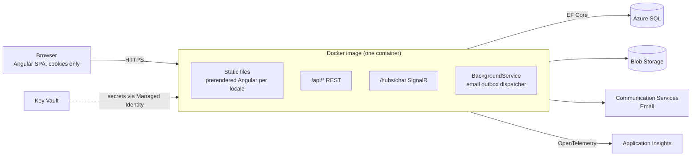
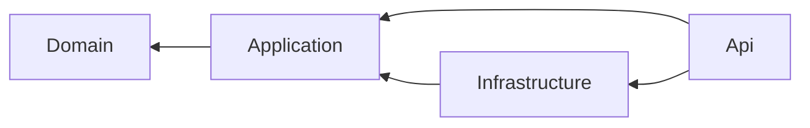

# Pracownia Bajkowe Cuda

<!-- Badges: replace OWNER/REPO once the GitHub repository exists.
[](https://github.com/OWNER/REPO/actions/workflows/ci.yml)
[](https://github.com/OWNER/REPO/actions/workflows/codeql.yml)
-->

Mobile-first one-page website for a custom toy-sewing **service** (not a shop). Visitors see the About, Gallery,
Pricing and Contact sections. Registered customers chat with the owner, the owner turns conversations into orders,
and customers follow those orders.

The project is also a portfolio piece for **Docker, Azure and CI/CD**: one container, infrastructure as code,
and a build-once / promote pipeline.

> **Status:** Phase 0 (repository foundation). The roadmap and the full specification are in
> [docs/PLAN.md](docs/PLAN.md); decisions are logged in [docs/DECISIONS.md](docs/DECISIONS.md).

## Stack

| Area | Technology |
|---|---|
| Backend | ASP.NET Core (.NET 10), Clean Architecture, EF Core + SQL Server / Azure SQL, ASP.NET Core Identity, SignalR |
| Frontend | Angular 22 (standalone, signals, zoneless), SCSS, `@angular/localize` (en, de, fr, es, pl), static prerendering |
| Packaging | One Docker image: ASP.NET Core serves the API, the SignalR hub and the prerendered Angular files |
| Azure | Container Apps, Azure SQL, Blob Storage, Key Vault, Communication Services Email, Application Insights (Bicep) |
| CI/CD | GitHub Actions: PR checks → staging automatically → production after manual approval, Azure login through OIDC |

## Architecture



Backend layering (dependencies point inwards; the Domain project has no framework dependencies):



## Repository layout

```
BajkoweCuda.sln
src/backend/BajkoweCuda.Domain           entities, value objects, domain rules
src/backend/BajkoweCuda.Application      use-case handlers, DTOs, ports
src/backend/BajkoweCuda.Infrastructure   EF Core, Identity, Blob, Email
src/backend/BajkoweCuda.Api              HTTP API, SignalR hub, static hosting
src/frontend                             Angular workspace
tests/                                   unit and integration tests
docs/                                    PLAN.md, DECISIONS.md
.github/                                 workflows, Dependabot, PR template
docker-compose.yml                       local SQL Server, Azurite, Mailpit
```

## Run it locally

Prerequisites: .NET 10 SDK, Node.js 26 (or 24 LTS), Docker with Compose v2.

```bash
# 1. Local dependencies: SQL Server, Azurite (Blob emulator), Mailpit (SMTP + web UI on http://localhost:8025)
cp .env.example .env          # then set MSSQL_SA_PASSWORD in .env
docker compose up -d

# 2. API on http://localhost:5080
dotnet run --project src/backend/BajkoweCuda.Api

# 3. Frontend on http://localhost:4200 (proxies /api, /hubs and /health to the API)
cd src/frontend
npm ci
npm start
```

Check that everything is wired up:

```bash
curl http://localhost:5080/health/live     # Healthy (directly)
curl http://localhost:4200/health/live     # Healthy (through the Angular dev-server proxy)
```

## Build, test, lint

```bash
dotnet build BajkoweCuda.sln                    # warnings are errors
dotnet test --solution BajkoweCuda.sln          # Microsoft.Testing.Platform runner

cd src/frontend
npm test                                        # Vitest, single run
npm run lint                                    # ESLint (angular-eslint)
npm run format:check                            # Prettier
npm run build
```

## CI

| Workflow | Trigger | What it does |
|---|---|---|
| [`ci.yml`](.github/workflows/ci.yml) | PR, push to `main` | Backend build + tests + vulnerable-package check · frontend format, lint, tests, build, `npm audit` · compose file validation |
| [`codeql.yml`](.github/workflows/codeql.yml) | PR, push to `main`, weekly | CodeQL for C#, JavaScript/TypeScript and GitHub Actions |
| [`dependabot.yml`](.github/dependabot.yml) | weekly | NuGet, npm, GitHub Actions and docker-compose image updates |

Actions are pinned to commit SHAs and every workflow declares minimal `permissions`.
The deployment pipeline (staging → approval → production) arrives in Phase 2.

## License

[MIT](LICENSE)
